# cc-things

dimboknv's Claude Code plugins, in the marketplace `dimboknv-cc-things`.

## planning

Three skills that form one loop of work.

- `/planning:brainstorm` — a design session: facts from the tree first, then one fork at a time,
  ending in a summary the owner confirms.
- `/planning:make-plan` — a plan whose premises are checked against the tree and whose tasks carry
  `After:` lines, reviewed before it runs.
- `/planning:exec-plan` — runs the plan: every task whose `After:` is met runs as a lane in its own
  worktree, one integrator merges each wave, then the whole-tree check and the review rounds.

The skills assume agterm for the fork page, the peer and the
status page, and [revmux](https://github.com/umputun/revmux) for review rounds. Outside agterm a fork
goes to the chat as a message; without revmux the `plan-review` agent reviews a plan.



How each skill runs inside, step by step: [docs/diagrams](docs/diagrams/README.md).

### Install

planning depends on three plugins from other marketplaces: `revmux`, `revdiff` and
`diagram-design`. Claude Code installs them with planning, but only from a marketplace you have
already added. Add all three first, then this one:

```
/plugin marketplace add umputun/revmux
/plugin marketplace add umputun/revdiff
/plugin marketplace add cathrynlavery/diagram-design
/plugin marketplace add dimboknv/cc-things
/plugin install planning@dimboknv-cc-things
```

Without one of the three marketplaces the install warns that a dependency was not installed,
and planning does not load, not even `/planning:brainstorm`.

### Programs on `PATH`

The plugins bring skills, not programs. Each program below is checked where a skill calls it,
and a missing one costs only the step that needs it.

| Program | Used for | Install | Without it |
|---|---|---|---|
| `revmux` | review rounds of a plan and of a run | `brew install umputun/apps/revmux` | `/planning:exec-plan` stops before it starts; `/planning:make-plan` reviews the plan with the `plan-review` agent |
| `revdiff` | the owner's review of the branch at the end of a run | `brew install umputun/apps/revdiff` | the run report is the end, the pull requests are the next step |
| `claude` | the review agents of revmux and the Claude peer | [Claude Code](https://code.claude.com/docs) | `/planning:exec-plan` stops before it starts |
| `codex` | the second model of the review rounds and the Codex peer | `brew install --cask codex` | `/planning:exec-plan` runs its review rounds on the profile `claude-only`; `/planning:make-plan` offers the `plan-review` agent instead of the `plan` round; `peer codex` is refused |
| `agtermctl`, with the agterm app | the fork page, the picker, the peer pane and the status page | `brew install --cask umputun/apps/agterm` | a fork goes to the chat as a message, a question to Claude Code's own picker; no peer; the status page is only a file in the run's journal |
| `mailbox-chat.py` | messages between the lead and the peer | agterm cookbook, see below | the peer is refused at start |
| `python3`, 3.9 or newer | the fork page, the picker and the acceptance check of `/planning:make-plan`; the status page and the run audit of `/planning:exec-plan` | `brew install python`, or the `python3` of `xcode-select --install` | those scripts do not run; the status page never appears, with no error |

The peer also needs the `mailbox-chat` skill and the mailbox hooks of Claude Code, of Codex and
of agterm. The `two-agent-mailbox-chat` recipe of the
[agterm cookbook](https://github.com/umputun/agterm/tree/master/cookbook) installs
`mailbox-chat.py`, the skill and the hooks: follow its Setup steps. Without them, run the
skills with `no peer`.

The menu item webrev of `/planning:make-plan`, the owner's own reading of a plan in the agterm
overlay, needs the `webrev` skill among the user's skills. planning does not ship it; without
it the item says so and returns to the menu.

Link the plugin's review lens and profiles into revmux's user layer once. The command runs
under `sh`, so it works from any shell, fish included, and it finds the plugins under
`${CLAUDE_CONFIG_DIR:-~/.claude}`:

```
sh -c '
P=${CLAUDE_CONFIG_DIR:-$HOME/.claude}/plugins/marketplaces/dimboknv-cc-things/plugins/planning/revmux
R=$HOME/.config/revmux
mkdir -p "$R/lenses" "$R/prompts/profiles"
ln -sf "$P/lenses/plan.md" "$R/lenses/plan.md"
ln -sf "$P/prompts/profiles/plan.md" "$P/prompts/profiles/plan-recheck.md" "$R/prompts/profiles/"
'
```

### Project rules

A project tells the skills where its plans live, its gates, the records that bind a design and
its review profiles in `.claude/planning/rules.md`, at the top of the checkout or in any directory
above it; `${XDG_CONFIG_HOME:-~/.config}/cc-things/planning/rules.md` serves every project
without one. The sections and their defaults: `plugins/planning/references/rules.md`.

### A plan across several repositories

One plan may change several repositories. Each task changes one of them and names it with a
`Repo:` line, a directory relative to where the session starts; a change in two repositories is
two tasks joined by `After:`. Start the session that writes the plan and the one that runs it
from the directory that holds every repository of the plan, so all of them are inside its
working directory, and keep the rules file there. The run cuts a branch of the same name in each
repository and reviews each one in its own revmux round. A plan kept outside git, such as in that
common directory, is never committed: the run ticks it in place and moves it to `completed/`
beside it. A light plan has one repository. The `Environment` section of the rules says how one
repository builds against another's unpushed branch.
