# How the planning skills run

The pictures are drawn with diagram-design. Each `.svg` has its source beside it, an `.html` file
that opens in a browser. The loop of the three skills is on the [main README](../../README.md).

## brainstorm

The session, from the peer question to the end menu:

One fork in detail, its picture and the owner's answer:

## make-plan

The steps, from the rules to the menu:

The review menu, the triage of findings and the verdict:

## exec-plan

The phases of a run, its stops and the continuation:

One wave: the lanes and their integrator:

